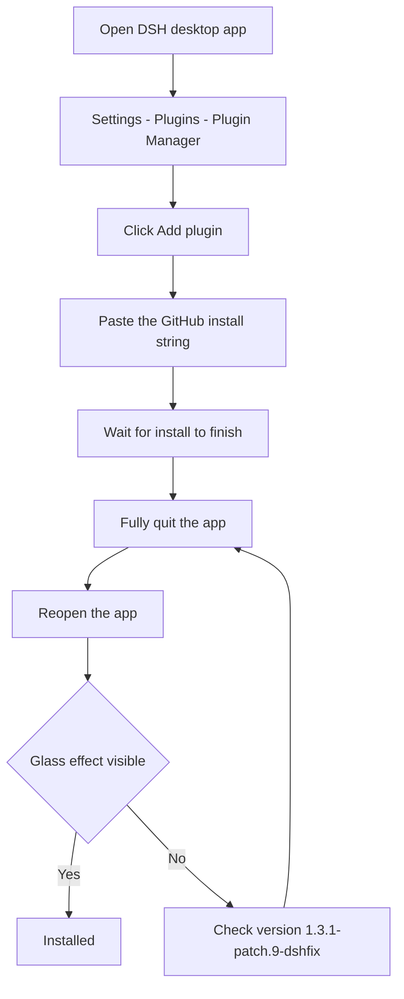
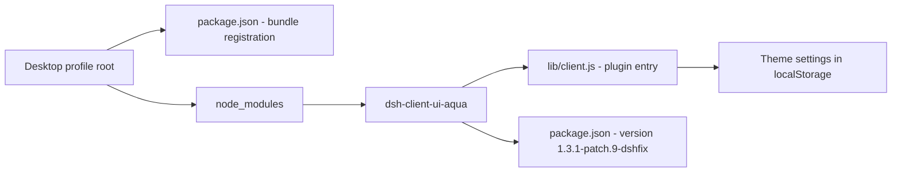
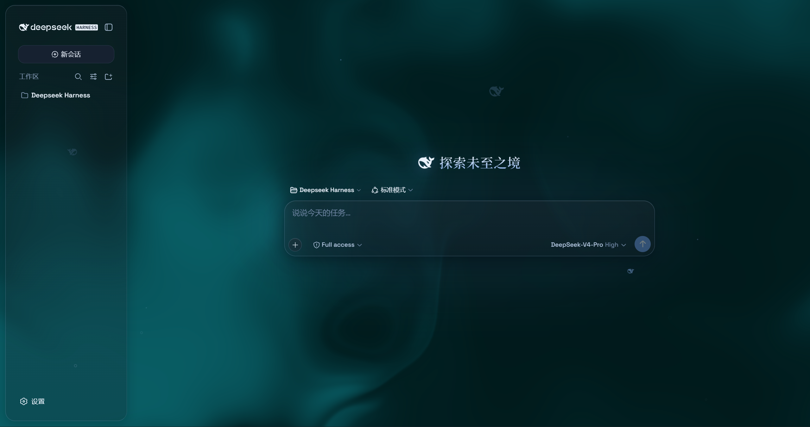
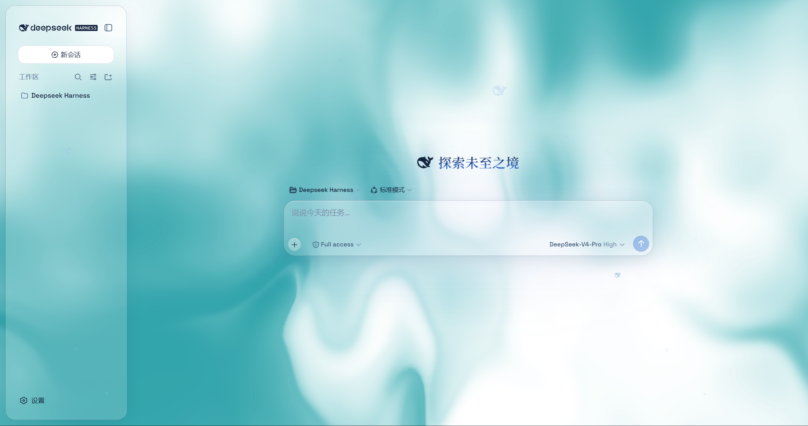
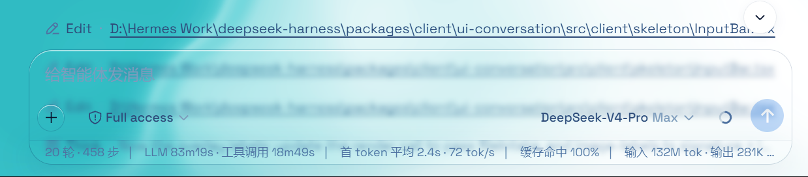
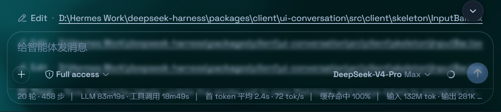

# dsh-client-ui-aqua — DSH desktop glass theme


Install it on the DSH desktop app and the interface turns into frosted glass: header, sidebar, composer, stats line and trajectory view become floating glass panes over a living fluid board or your own wallpaper. Turn the master switch off and the stock UI returns exactly.

English | [中文](README.zh.md)

---

## ⚡ At a glance

| Item | Value |
|---|---|
| **Supported desktop version** | **DSH 0.2.1-rc.5** (verified ✅) |
| **Plugin version** | `1.3.1-patch.9-dshfix` |
| **Platforms** | macOS ✅ / Windows ✅ (same install method) |
| **How to install** | Plugin Manager → `github:hkd-Duo/dsh-client-ui-aqua-desktop` |
| **One required step** | **Fully quit and reopen the app** after installing |
| **Default state** | Theme is **on** after install |

### Install flow



### Version compatibility

| DSH desktop version | Status | Notes |
|---|---|---|
| **0.2.1-rc.5** | ✅ **Verified** | Current baseline of this repo |
| 0.2.1-rc.3 | ⚠️ Untested | Baseline of the upstream repair fork |
| 0.2.0 / 0.1.7 line | ⚠️ Untested | Allowed by peer ranges, never run |
| 0.1.2-rc.1 and earlier | ❌ Not supported | Old kernel, API changed |

---

## 1. Install

### Method A — Plugin Manager (recommended, macOS and Windows)

1. Open the **DSH desktop app**
2. Go to **Settings → Plugins → Plugin Manager**
3. Click **Add plugin**
4. Enter: `github:hkd-Duo/dsh-client-ui-aqua-desktop`
5. Wait for the install to finish
6. **Fully quit the app** and reopen it (macOS `⌘Q`; Windows tray → Quit)
7. The interface should turn glassy immediately

> Step 6 is required: the plugin appends itself to the profile's bundle list, and the host reads that list only at startup.

### Method B — local directory (development / offline)

Lets you edit files and see the result after a window reload (macOS `⌘R`) without reinstalling.

```sh
git clone https://github.com/hkd-Duo/dsh-client-ui-aqua-desktop.git
dsh plugin --profile desktop add link:/absolute/path/to/dsh-client-ui-aqua-desktop
```

- macOS example: `link:/Users/yourname/dsh-client-ui-aqua-desktop`
- Windows example: `link:C:\Users\yourname\dsh-client-ui-aqua-desktop`

The path must be **absolute**; relative paths are rejected. On Windows you do not need the `dsh` command — Method A is enough.

---

## 2. File locations

### Directory diagram



### macOS

| Item | Path |
|---|---|
| App | `/Applications/DeepSeek Harness.app` or `~/Applications/DeepSeek Harness.app` |
| desktop profile root | `~/.dsh/profiles/desktop/` |
| **Plugin itself** | `~/.dsh/profiles/desktop/node_modules/dsh-client-ui-aqua/` |
| Plugin entry file | `~/.dsh/profiles/desktop/node_modules/dsh-client-ui-aqua/lib/client.js` |
| **Bundle registration** | `~/.dsh/profiles/desktop/package.json` → `dsh.profile.bundles` must contain `dsh-client-ui-aqua` |
| App data directory | `~/Library/Application Support/@deepseek-ai/dsh-desktop/` |
| **Theme settings** | `dsh.ui-aqua.*` keys in `Local Storage/leveldb/` under that directory |
| Bundled CLI | `/Applications/DeepSeek Harness.app/Contents/Resources/runtime/cli/bin/dsh` |

### Windows

| Item | Path |
|---|---|
| App | Determined by the installer (Start-menu shortcut → right-click → **Open file location**) |
| desktop profile root | `%USERPROFILE%\.dsh\profiles\desktop\` |
| **Plugin itself** | `%USERPROFILE%\.dsh\profiles\desktop\node_modules\dsh-client-ui-aqua\` |
| Plugin entry file | `%USERPROFILE%\.dsh\profiles\desktop\node_modules\dsh-client-ui-aqua\lib\client.js` |
| **Bundle registration** | `%USERPROFILE%\.dsh\profiles\desktop\package.json` → `dsh.profile.bundles` |
| App data directory | `%APPDATA%\@deepseek-ai\dsh-desktop\` |
| **Theme settings** | `dsh.ui-aqua.*` keys in `Local Storage\leveldb\` under that directory |

### Post-install check (both must hold)

1. The plugin page shows version **`1.3.1-patch.9-dshfix`**
2. `package.json` → `dsh.profile.bundles` contains **`dsh-client-ui-aqua`**

---

## 3. Usage

### Master switch

**Settings → Plugins → the Aqua card**. The theme is **on by default**; turning it off removes every effect and restores the stock UI.

### Controls

**Settings → General → Appearance** (directly under the Appearance block, no heading of its own):

| Control | Effect |
|---|---|
| Mode | **Mica** = floating glass card layout; **Compatibility** = stock layout, material swapped only |
| Blur / Frost | Glass blur and frost strength (Mica mode) |
| Hue / Depth | Fluid backdrop colour and depth |
| Background brightness | Dark mode darkens (0–50), light mode brightens (50–100); 50 unchanged |
| Backdrop source | Fluid board / custom wallpaper (wallpaper has blur, brightness, delete) |
| Particle whale | Particle whale in the middle of the chat area |

The whole control block is hidden while the master switch is off.

### Switching modes

| Mode | Effect | Good for |
|---|---|---|
| **Mica** | Sidebar/header/composer become floating glass cards | Best look |
| **Compatibility** | Layout untouched, only the material becomes glass | Avoiding layout changes, coexisting with other plugins |

Change it in **Appearance → Mode**; it applies immediately.

### Updating

Use the plugin manager's update action, then **restart the app**. For `link:` installs, `git pull` and reload the window (`⌘R`).

### Uninstalling

```sh
dsh plugin --profile desktop remove dsh-client-ui-aqua
```

Or uninstall from the plugin manager, then **restart the app**. Every effect is a disposable handle and is released on removal.

---

## 4. Windows support

**Yes — the install is identical to macOS, nothing needs changing.**

Why:

1. The plugin is a pure client-side artifact (`dsh.client.platform = "web"`); the desktop app loads the **same frontend code** on every platform.
2. The fixes here contain no macOS-specific logic — the transparency rules match **class-name substrings** such as `[class*='centerCol']` and `[class*='rightbarCol']`, the same class names on Windows.
3. The desktop-only main-column fixes already target Windows custom-titlebar mode.
4. The install identifier `github:hkd-Duo/dsh-client-ui-aqua-desktop` is identical on both platforms.

Platform differences are limited to paths (see the tables above) and the absolute `C:\...` path when installing with `link:`.

**Three checks on Windows:**

| Check | Expected |
|---|---|
| Plugin page version | `1.3.1-patch.9-dshfix` |
| Visual effect | Clear frosted glass (sidebar, composer) |
| Controls | Aqua controls under Settings → General → Appearance |

All three up = working.

---

## 5. Changelog

| Version | Change |
|---|---|
| `patch.2` | Fixed appearance-row render crash (React #130); fixed boot error from the removed `settings.register` |
| `patch.3` | Fixed the main conversation column being covered by an opaque slab (glass only, no fluid) |
| `patch.4` | Fixed the Plugins page becoming unresponsive after enabling the theme |
| `patch.5` | Widened peer ranges for newer DSH releases |
| `patch.6` | Session list timestamps switched to a sans-serif face with tabular numerals |
| `patch.7` | (withdrawn) tried opaque large surfaces — not the root cause |
| `patch.8` | Fixed the blurry right half of the chat in Compatibility mode: the compat blur rule no longer applies to layout panels |
| `patch.9` | Adopted the 0.2 settings slot (`plugins.bundle.config`), excluded the sessionless header, fixed the composer hover scrollbar |

---

## 6. Two things not to install

**1. The bare npm name**

```sh
dsh plugin --profile desktop add dsh-client-ui-aqua   # ← unpatched older release
```

That name resolves to an old release that fails on the current DSH line.

**2. Packages without a bundle patch**

The plugin manager only manages composite bundles; a package without a `dsh.bundle.patch` declaration is rejected before installation. This repository includes it and installs normally.

---

## 7. Runtime behaviour

- No network requests, no filesystem or credential access, no `eval`, no telemetry
- State lives only in `localStorage` keys under `dsh.ui-aqua.*`
- Installation runs no build script — `lib/` ships prebuilt

## 8. Release artifacts and source archives

Every release page ([all releases](https://github.com/hkd-Duo/dsh-client-ui-aqua-desktop/releases)) carries two kinds of files.

### Uploaded by the workflow

| Asset | Purpose |
|---|---|
| `client.js` | the shipped frontend bundle, for auditing or manual comparison |
| `install.ps1` | upstream helper script, kept for provenance only |

### Auto-generated by GitHub

The **`Source code (zip)`** and **`Source code (tar.gz)`** entries at the bottom of the release page are **generated by GitHub**, not uploaded by this workflow:

- they are a **snapshot of the whole repository at that tag** (`src/`, `lib/`, all docs)
- useful for auditing, archiving, or a fully offline install
- **no build step needed** — `lib/` already ships prebuilt

**Installing offline from a source archive:**

1. Download `Source code (tar.gz)` and extract it
2. Install the extracted directory as a local plugin (absolute path required):

   ```sh
   dsh plugin --profile desktop add link:/absolute/path/to/extracted-directory
   ```

3. Fully quit and reopen the desktop app

## 9. Contributing

- Read [CONTRIBUTING.md](CONTRIBUTING.md) before opening an issue
- Please use the [issue templates](https://github.com/hkd-Duo/dsh-client-ui-aqua-desktop/issues/new/choose) — they ask for the DSH version, plugin version and self-check results
- Local development, pre-commit checks, PR flow and the release process are documented in [CONTRIBUTING.md](CONTRIBUTING.md)

## Screenshots









## License

This repository keeps the upstream `LICENSE` (**AGPL-3.0-only**). If AGPL is incompatible with your use case, do not install it.
