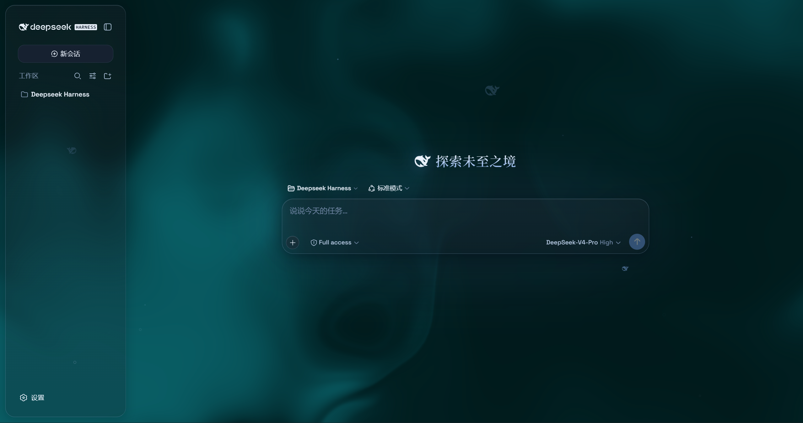
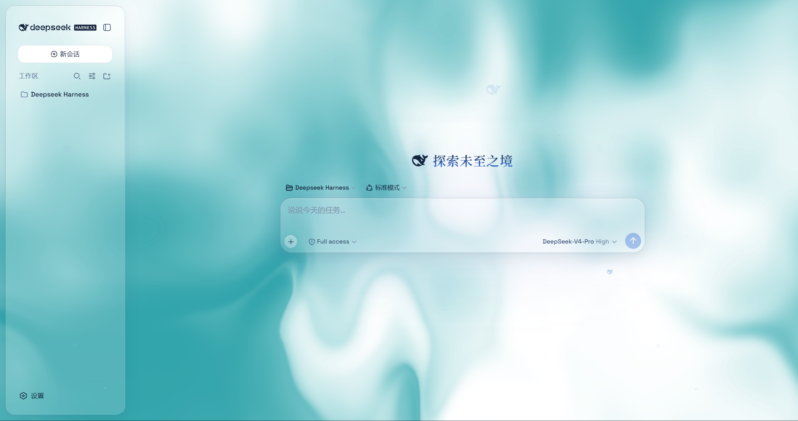
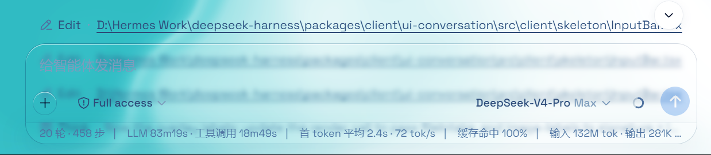
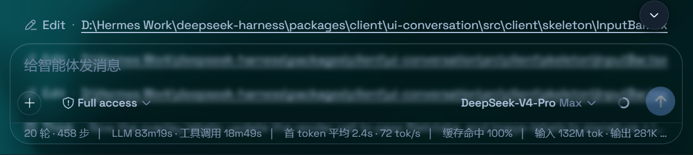

# dsh-client-ui-aqua —— DSH 桌面端玻璃主题

装到 DSH 桌面应用上，界面立刻变成磨砂玻璃：顶栏、侧边栏、输入框、统计行、轨迹视图都变成悬浮玻璃片，背景可以是流动流体板，也可以是你自己的壁纸。关掉总开关就完全还原原生界面。

当前版本：**`1.3.1-patch.9-dshfix`**（适配 DSH **0.2.1-rc.5**）

[English](README.md) | 中文

---

## 一、安装步骤

### 方式 A：插件管理器（推荐，macOS / Windows 通用）

1. 打开 **DSH 桌面应用**
2. 进入 **设置 → 插件 → 插件管理器（Plugin Manager）**
3. 点 **添加插件（Add plugin）**
4. 输入：

   ```
   github:hkd-Duo/sh-client-ui-aqua-desktop
   ```

5. 等待安装完成
6. **完全退出应用**再重新打开
   - macOS：`⌘Q`（不是关窗口）
   - Windows：托盘图标右键 → 退出，或任务管理器结束进程
7. 界面应立刻变成玻璃质感

> 第 6 步不能省：插件会把自己写进 profile 的 bundle 列表，宿主只在启动时读取。

### 方式 B：本地目录（开发/调试）

适合改源码或离线安装；改完只需刷新窗口（macOS `⌘R`），不用重装。

```sh
git clone https://github.com/hkd-Duo/sh-client-ui-aqua-desktop.git
dsh plugin --profile desktop add link:/绝对路径/sh-client-ui-aqua-desktop
```

- macOS 例：`link:/Users/你的用户名/sh-client-ui-aqua-desktop`
- Windows 例：`link:C:\Users\你的用户名\sh-client-ui-aqua-desktop`

路径必须是**绝对路径**，相对路径会被拒绝。Windows 上没有 `dsh` 命令也没关系，用方式 A 即可。

---

## 二、具体文件位置

### macOS

| 内容 | 路径 |
|---|---|
| 应用本体 | `/Applications/DeepSeek Harness.app` 或 `~/Applications/DeepSeek Harness.app` |
| desktop profile 根目录 | `~/.dsh/profiles/desktop/` |
| **插件本体** | `~/.dsh/profiles/desktop/node_modules/dsh-client-ui-aqua/` |
| 插件入口文件 | `~/.dsh/profiles/desktop/node_modules/dsh-client-ui-aqua/lib/client.js` |
| **bundle 注册位置** | `~/.dsh/profiles/desktop/package.json` → `dsh.profile.bundles` 应含 `dsh-client-ui-aqua` |
| 应用数据目录 | `~/Library/Application Support/@deepseek-ai/dsh-desktop/` |
| **主题设置存储** | 上述目录下 `Local Storage/leveldb/` 内的 `dsh.ui-aqua.*` 键 |
| 应用自带 CLI | `/Applications/DeepSeek Harness.app/Contents/Resources/runtime/cli/bin/dsh` |

### Windows

| 内容 | 路径 |
|---|---|
| 应用本体 | 由安装器决定（开始菜单快捷方式 → 右键 → **打开文件所在位置** 可确认） |
| desktop profile 根目录 | `%USERPROFILE%\.dsh\profiles\desktop\` |
| **插件本体** | `%USERPROFILE%\.dsh\profiles\desktop\node_modules\dsh-client-ui-aqua\` |
| 插件入口文件 | `%USERPROFILE%\.dsh\profiles\desktop\node_modules\dsh-client-ui-aqua\lib\client.js` |
| **bundle 注册位置** | `%USERPROFILE%\.dsh\profiles\desktop\package.json` → `dsh.profile.bundles` |
| 应用数据目录 | `%APPDATA%\@deepseek-ai\dsh-desktop\` |
| **主题设置存储** | 上述目录下 `Local Storage\leveldb\` 内的 `dsh.ui-aqua.*` 键 |

### 装好后的自检（两条都成立）

1. 插件页里 Aqua 的版本显示 **`1.3.1-patch.9-dshfix`**
2. `package.json` 的 `dsh.profile.bundles` 里有 **`dsh-client-ui-aqua`**

---

## 三、使用步骤

### 1. 总开关

**设置 → 插件 → Aqua 卡片**，里面是总开关。主题**装完默认开启**；关掉后所有效果移除，界面还原原生。

### 2. 调参数

**设置 → 通用设置 → 外观**（在「外观」区块正下方，没有独立标题）：

| 控件 | 作用 |
|---|---|
| 模式 | **云母（Mica）**= 悬浮玻璃卡片布局；**兼容模式**= 保留原版排版，只换材质 |
| 模糊度 / 磨砂度 | 云母模式下玻璃的模糊与磨砂强度 |
| 色调 / 颜色深浅 | 流体背景的色相与深浅 |
| 背景亮度 | 深色模式压暗（0–50）、浅色模式提亮（50–100），50 为原样 |
| 背景来源 | 流体板 / 自定义壁纸（壁纸另带模糊度、亮度、删除） |
| 粒子鲸鱼 | 聊天区中央的粒子鲸鱼开关 |

总开关关闭时，整块调节会自动隐藏。

### 3. 切换模式

在「外观 → 模式」里切换，立即生效：

- **云母**：侧栏/顶栏/输入框变成悬浮玻璃卡片（观感最好）
- **兼容模式**：不改布局，只把材质换成玻璃（最保守）

### 4. 更新

插件管理器里点更新 → **重启应用**。`link:` 安装的则 `git pull` 后刷新窗口（`⌘R`）。

### 5. 卸载

```sh
dsh plugin --profile desktop remove dsh-client-ui-aqua
```

或在插件管理器里卸载，然后**重启应用**。

---

## 四、Windows 支持

**可以，安装方式与 macOS 完全一致，不需要改任何东西。**

理由：

1. 插件是纯客户端产物（`dsh.client.platform = "web"`），桌面应用在各平台加载的是**同一份前端代码**
2. 本仓库的修复不含 macOS 专属逻辑 —— 透明规则用的是 `[class*='centerCol']`、`[class*='rightbarCol']` 这类**类名子串匹配**，Windows 上同样是这些类名
3. 桌面端专用的主栏背景修复本身就覆盖 Windows 自定义标题栏模式
4. 安装标识 `github:hkd-Duo/sh-client-ui-aqua-desktop` 两端完全一样

平台差异只在路径（见上面表格）以及 `link:` 安装要用 `C:\...` 绝对路径。

**Windows 上自证三点：**

1. 插件页版本 = `1.3.1-patch.9-dshfix`
2. 界面出现明显磨砂玻璃效果
3. 设置 → 通用设置 → 外观 下方出现 Aqua 调节项

三条都成立即正常工作。

---

## 五、更新记录

| 版本 | 内容 |
|---|---|
| `patch.2` | 修复外观行渲染崩溃（React #130）；修复启动时报 `settings.register` 不存在 |
| `patch.3` | 修复主对话区被不透明容器盖住、只剩毛玻璃没有流体 |
| `patch.4` | 修复开启主题后「插件」页点击无反应 |
| `patch.5` | 放宽 peer 版本范围，适配新版 DSH |
| `patch.6` | 会话列表时间戳改用无衬线体 + 等宽数字 |
| `patch.7` | （已废弃）曾调整大表面透明度，非根因 |
| `patch.8` | 修复兼容模式右侧聊天区发糊：兼容模式模糊规则不再作用于布局面板 |
| `patch.9` | 适配 0.2 设置入口（`plugins.bundle.config`）、空页头排除、输入框悬停横向滚动条修复 |

---

## 六、两种不要装的形式

**1. npm 裸包名**

```sh
dsh plugin --profile desktop add dsh-client-ui-aqua   # ← 未经修补的旧版
```

该名称解析到旧发布版，在当前 DSH 线会报错。

**2. 没有 bundle patch 的包**

插件管理器只管理组合包，`package.json` 里缺少 `dsh.bundle.patch` 声明的包会在安装前直接被拒绝。本仓库已包含该声明，可以正常安装。

---

## 七、运行行为

- 无网络请求、无文件/凭据访问、无 `eval`、无遥测
- 状态只存于 `localStorage` 的 `dsh.ui-aqua.*` 键
- 安装过程不执行任何构建脚本（`lib/` 随包提供预构建产物）

## 截图








